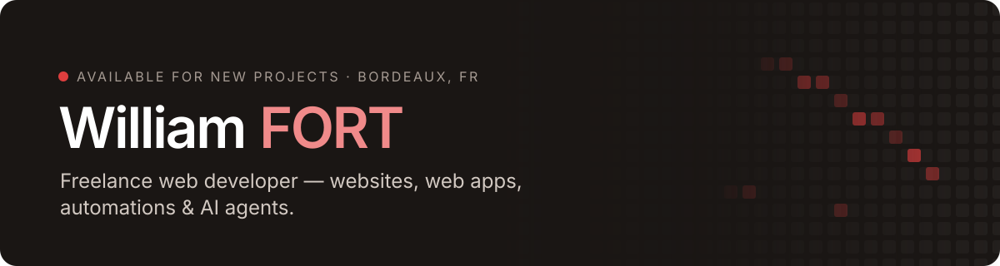

  

 

### Hey, I'm William 👋

I'm a freelance full-stack developer based in **Bordeaux, France**, and part of the team at [**Very Berry**](https://github.com/very-berry-agency).
I build fast, hand-coded products for small businesses and startups.

### 🛠️ Stack

  
  
  
  
   
  
  
  
  
   
  
  
  
  

---

  <picture>
    <source media="(prefers-color-scheme: dark)" srcset="images/github-contribution-grid-snake-dark.svg" />
    <source media="(prefers-color-scheme: light)" srcset="images/github-contribution-grid-snake.svg" />
    
  </picture>

---

### 📊 Stats

### 📬 Let's work together

Got a project in mind? I usually reply within 48 h.

  
  
  

